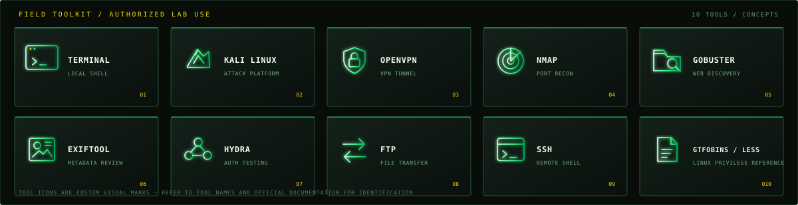

 

**TRYHACKME / BROOKLYN NINE-NINE / LINUX PENETRATION TESTING**

 

<em>Observe the surface. Understand the signal. Document the evidence.</em>

---

  

## CASE FILE / 001

**Brooklyn Nine-Nine** is a practical cybersecurity learning project based on the TryHackMe training room. The repository combines the lab's learning notes with a custom cyber-operations frontend built with HTML, CSS, JavaScript and Three.js.

The goal is to develop a repeatable penetration-testing mindset: understand the environment, identify the attack surface, investigate exposed services, validate evidence, and explain the security implications.

> **Current status:** the lab is in progress. This repository does not publish room answers, flags, credentials, target-specific exploitation steps, or a walkthrough while the room's sharing restrictions apply.

---

  
   
  

### TOOLKIT / WHAT EACH TOOL IS FOR

| Tool | Role in the lab |
|:--|:--|
| **Terminal / Bash** | Run commands, inspect output, manage files and keep a reproducible workflow. |
| **Kali Linux** | Local security-testing workstation. |
| **OpenVPN** | Connect the local Kali machine to the authorized TryHackMe network. |
| **Nmap** | Discover reachable hosts, open ports and—when needed—service details. |
| **Gobuster** | Discover web paths and resources during authorized HTTP enumeration. |
| **ExifTool** | Inspect metadata in supported files and media. |
| **FTP client** | Interact with the FTP service and understand access permissions. |
| **Hydra** | Study authentication-testing risks in the authorized lab context. |
| **SSH** | Establish secure remote sessions when valid lab access is available. |
| **GTFOBins / less** | Reference Linux binaries and understand why unsafe privilege rules matter. |

These entries describe the planned study toolkit and its general purpose; they are not claims that every tool has already been used or that any finding has been confirmed.

### PROTOCOLS & SYSTEM CONCEPTS

---

  

### HOW THE LAB WILL BE STUDIED

| Phase | Focus | What we want to understand |
|:--:|:--|:--|
| **00** | Environment setup | VPN connectivity, target scope and local tooling. |
| **01** | Web reconnaissance | HTTP, browser inspection, source review and content discovery. |
| **02** | Network scanning | TCP, SYN scanning, port states and Nmap interpretation. |
| **03** | Service / FTP review | Service identification, FTP behavior and file permissions. |
| **04** | SSH / authentication | Remote access, password security and authentication controls. |
| **05** | Linux enumeration | Users, groups, processes, directories and permissions. |
| **06** | Privilege escalation | Sudo policy, binary behavior and privilege boundaries. |
| **07** | Defensive review | Detection, hardening, remediation and reporting. |

**Method:** learn the concept → perform the authorized lab exercise → interpret the output → document the defensive lesson.

---

  

### PROJECT DOCUMENTATION

  

**Documentation is divided into four tracks:**

| Track | What it contains |
|:--|:--|
| [Fundamentals](docs/README.md#01--fundamentals) | Networking, TCP/IP, HTTP, Linux, permissions and authentication. |
| [Lab Methodology](docs/README.md#02--lab-methodology) | Instructor-aligned sequence: environment, web, network, FTP, SSH, Linux and privilege concepts. |
| [Defensive Security](docs/README.md#03--defensive-security) | Detection, monitoring, hardening and remediation. |
| [References & Templates](docs/README.md#04--references--templates) | Official sources and reusable technical-note templates. |

**Main navigation:** [Documentation Index](docs/README.md) · [Learning Plan](docs/LEARNING-PLAN.md) · [Tool Reference](tools/README.md) · [Three.js Frontend](site/)

### FRONTEND / VISUAL SYSTEM

The globe uses synthetic demonstration data for visual effect only. It does not display real network traffic, live attacks, or threat-intelligence feeds.

---

  

### RULES OF ENGAGEMENT

- All testing is limited to the TryHackMe-provided training environment or systems with explicit authorization.
- Do not reuse lab techniques against third-party systems without permission.
- Do not commit VPN profiles, credentials, API keys, flags, or other secrets.
- Keep room-specific answers and walkthrough material unpublished while TryHackMe sharing restrictions apply.
- Treat all interface globe routes and telemetry-like visuals as **synthetic demo data**.

---

**JOHN ROOT**  
CYBERSECURITY / OFFENSIVE SECURITY / PENETRATION TESTING

 

<em>Learn deliberately. Test ethically. Verify everything.</em>

