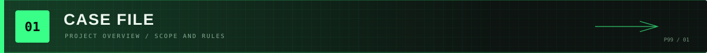
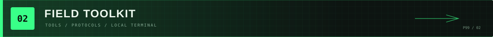
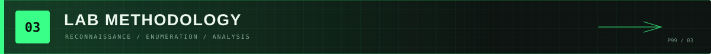
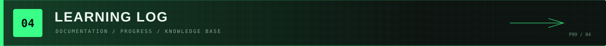
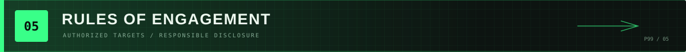

 

**TRYHACKME / BROOKLYN NINE-NINE / LINUX PENETRATION TESTING**

 

<em>Observe the surface. Understand the signal. Document the evidence.</em>

---

  

## CASE FILE / 001

**Brooklyn Nine-Nine** is a guided Linux penetration-testing lab documented in the same order demonstrated by the instructor. The practical workflow covers web reconnaissance, image metadata review, directory discovery, Nmap scanning, FTP investigation, password auditing, SSH access, Linux enumeration and privilege-boundary analysis.

This repository contains concise technical notes for the tools and concepts used in that workflow, together with the project's separate cyber-operations frontend built with HTML, CSS, JavaScript and Three.js. The emphasis is on understanding each step—not collecting answers.

> **Current status:** the lab is in progress. This repository does not publish room answers, flags, credentials, target-specific exploitation steps, or a walkthrough while the room's sharing restrictions apply.

---

  
   
  

### TOOLKIT / WHAT EACH TOOL IS FOR

| Tool | Role in the instructor's workflow |
|:--|:--|
| **Kali Terminal / Bash** | Run commands, inspect output and manage downloaded files. |
| **OpenVPN** | Connect the local Kali workstation to the authorized TryHackMe network. |
| **Firefox / Developer Tools** | Inspect the HTTP page, delivered source and browser requests. |
| **ping** | Check basic reachability of the deployed lab host. |
| **wget** | Retrieve a web image for local metadata inspection. |
| **ExifTool** | Review metadata embedded in the downloaded image. |
| **SecLists** | Provide candidate paths for web content discovery. |
| **Gobuster** | Enumerate candidate directories and files over HTTP. |
| **Nmap** | Perform TCP SYN scanning and service/version identification. |
| **FTP client** | Review FTP authentication, directory access and file-transfer behavior. |
| **RockYou** | Supply a known wordlist for the controlled password-auditing stage. |
| **Hydra** | Demonstrate password-based authentication testing in the authorized lab. |
| **SSH** | Access the Linux service using authorized lab credentials. |
| **sudo / GTFOBins** | Review delegated privileges and the security implications of permitted Unix binaries. |

This list follows the tools and interfaces shown in the lesson. It does not publish target-specific results, credentials, flags or exploitation commands.

### PROTOCOLS & SYSTEM CONCEPTS

---

  

### HOW THE LAB WILL BE STUDIED

| Phase | Instructor step | Technical focus |
|:--:|:--|:--|
| **00** | Environment setup | Start the lab, connect through VPN and verify host reachability. |
| **01** | Web reconnaissance | Inspect the page and HTML source; retrieve the image and review its metadata. |
| **02** | Directory discovery | Use SecLists and Gobuster to identify candidate web resources. |
| **03** | Network scanning | Use Nmap for TCP SYN scanning and service/version identification. |
| **04** | FTP investigation | Review FTP access behavior, directory listing and file-transfer permissions. |
| **05** | SSH authentication | Study RockYou, Hydra and remote SSH authentication. |
| **06** | Linux enumeration | Inspect the authenticated account, home directories and permission context. |
| **07** | Privilege review | Examine sudo policy and use GTFOBins to understand the permitted binary's risk. |

**Method:** follow the instructor's order → understand the protocol or operating-system feature → interpret the observed behavior → connect it to the relevant security control.

---

  

### PROJECT DOCUMENTATION

  

**Documentation is divided into four tracks:**

| Track | What it contains |
|:--|:--|
| [Fundamentals](docs/README.md#01--fundamentals) | Networking, HTTP, metadata, authentication and Linux concepts required for this room. |
| [Instructor Workflow](docs/README.md#02--instructor-workflow) | The practical sequence from web inspection through privilege review. |
| [Defensive Context](docs/README.md#03--defensive-context) | Detection and hardening notes tied to the services and techniques in the lesson. |
| [References & Templates](docs/README.md#04--references--templates) | Official manuals and concise technical-note templates. |

**Main navigation:** [Documentation Index](docs/README.md) · [Learning Plan](docs/LEARNING-PLAN.md) · [Tool Reference](tools/README.md) · [Three.js Frontend](site/)

### FRONTEND / VISUAL SYSTEM

The globe uses synthetic demonstration data for visual effect only. It does not display real network traffic, live attacks, or threat-intelligence feeds.

---

  

### RULES OF ENGAGEMENT

- All testing is limited to the TryHackMe-provided training environment or systems with explicit authorization.
- Do not reuse lab techniques against third-party systems without permission.
- Do not commit VPN profiles, credentials, API keys, flags, or other secrets.
- Keep room-specific answers and walkthrough material unpublished while TryHackMe sharing restrictions apply.
- Treat all interface globe routes and telemetry-like visuals as **synthetic demo data**.

---

**JOHN ROOT**  
CYBERSECURITY / OFFENSIVE SECURITY / PENETRATION TESTING

 

<em>Learn deliberately. Test ethically. Verify everything.</em>

