<!--
PRACTICAL EVIDENCE — BROOKLYN NINE-NINE
Original screenshots are stored in ../assets/evidence/.
Sensitive captures must be redacted before public display.
-->

  
  
<strong>AUTHORIZED LAB • EVIDENCE-DRIVEN WALKTHROUGH • CASE 001</strong>

  
TRYHACKME / BROOKLYN NINE-NINE / LINUX PENETRATION TESTING

# Practical Evidence

A chronological, evidence-led walkthrough of the authorized TryHackMe **Brooklyn Nine-Nine** lab. Each section pairs an original capture with a concise explanation of the action, the technical observation and its relevance to the assessment.

> **Publication safety:** Do not publish recovered passwords, user/root flag values, VPN credentials, tokens or private configuration. The captures for Hydra authentication, flag discovery/validation and any terminal output containing secrets must be redacted and re-uploaded before they are displayed publicly. Redact values without altering the surrounding command output.

## Assessment overview

| Item | Details |
|:--|:--|
| Platform | TryHackMe |
| Room | Brooklyn Nine-Nine |
| Environment | Kali Linux / assigned TryHackMe lab network |
| Scope | Authorized educational environment |
| Methodology | VPN validation → reconnaissance → enumeration → authentication testing → post-exploitation → privilege escalation |
| Evidence archive | 20 original screenshots in `assets/evidence/` |

**Skills practiced:** OpenVPN · ICMP · Nmap · HTTP inspection · source-code review · ExifTool · Gobuster · FTP · wordlist analysis · Hydra · SSH · Linux enumeration · sudo policy review · GTFOBins · technical reporting.

---

## Practical walkthrough

### 01 — VPN Tunnel Establishment

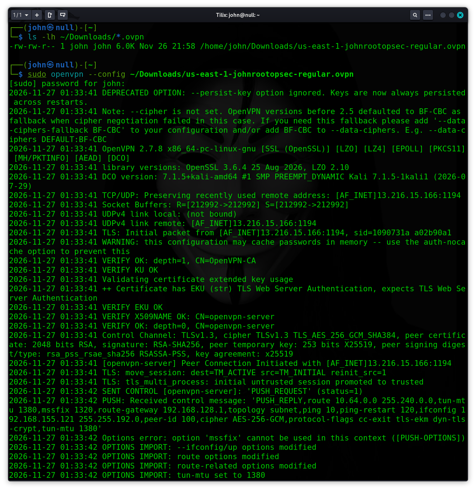

**Action:** Established the OpenVPN connection to the TryHackMe lab network.

**Technical significance:** A successful VPN connection provides the network path required to reach the assigned target. Confirm tunnel establishment before conducting discovery activity.

### 02 — VPN Connectivity Verification

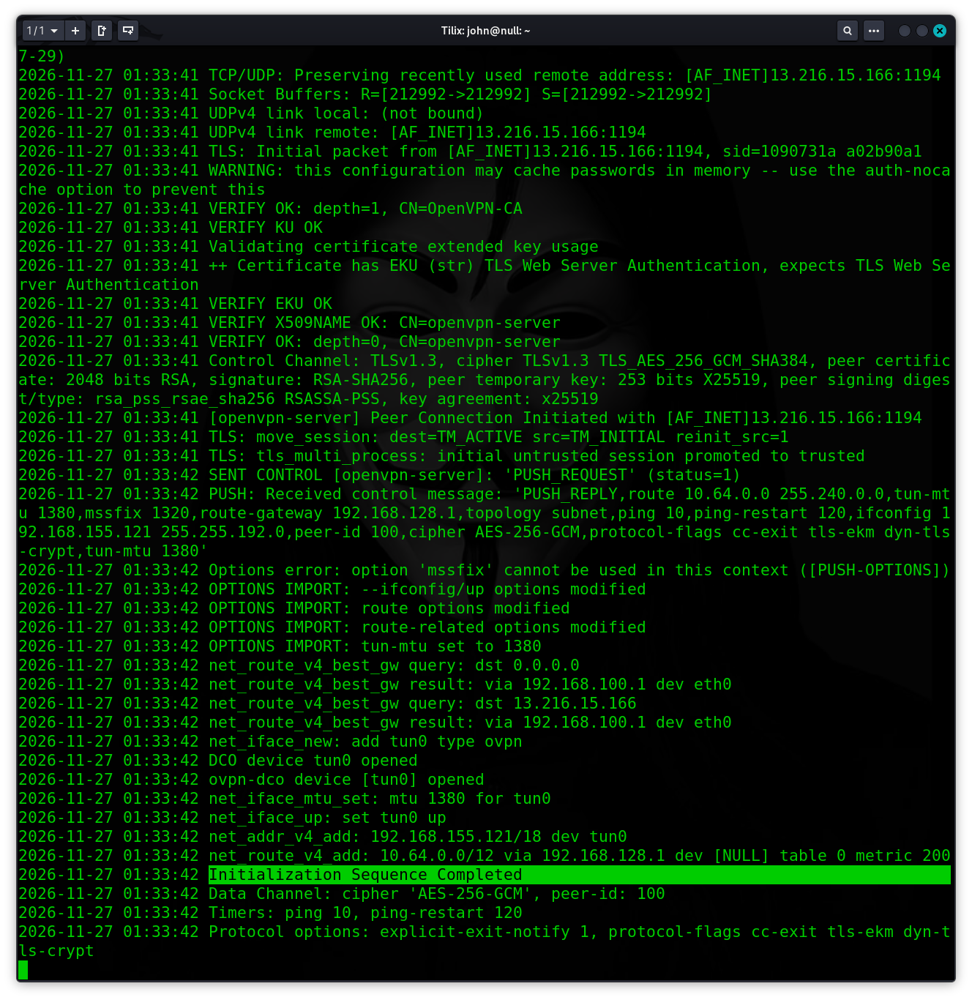

**Action:** Verified that the lab tunnel was active and that network communication was available.

**Technical significance:** Connectivity checks help distinguish routing or VPN problems from target-side service availability.

### 03 — Network Discovery and Nmap Reconnaissance

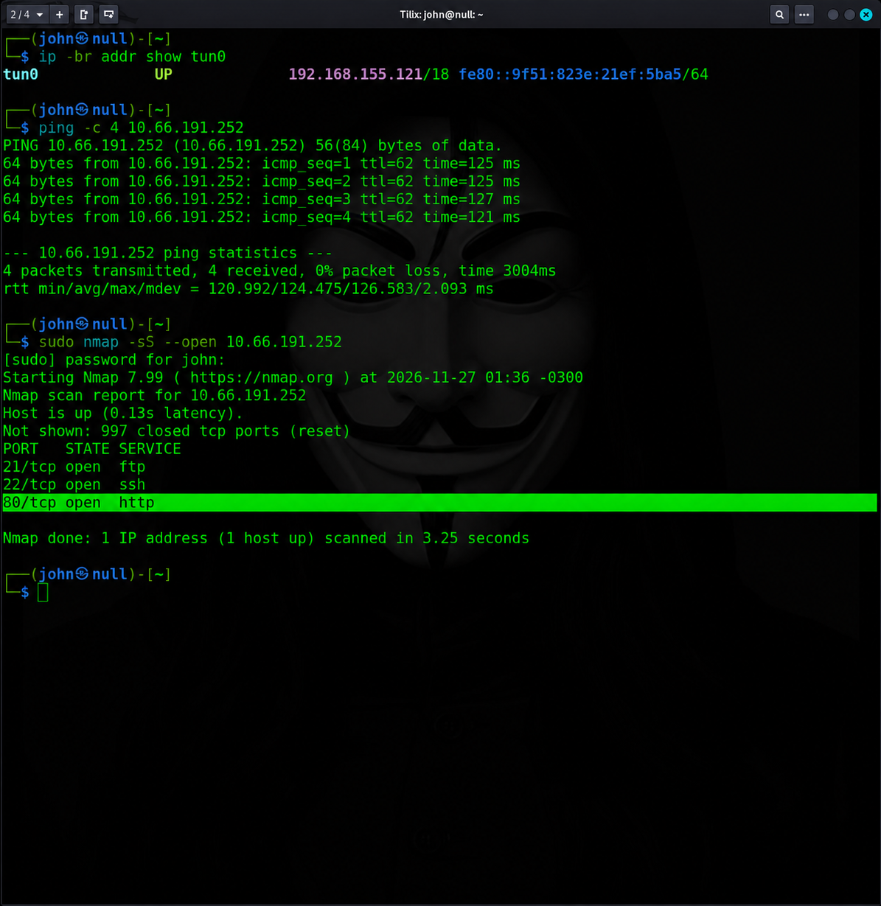

**Action:** Performed host and port discovery against the authorized target.

**Observation:** The recorded scan identified the target as reachable and exposed TCP services associated with FTP (21), SSH (22) and HTTP (80).

**Technical significance:** Port discovery defines the externally reachable attack surface and guides service-specific enumeration.

### 04 — HTTP Service Reconnaissance

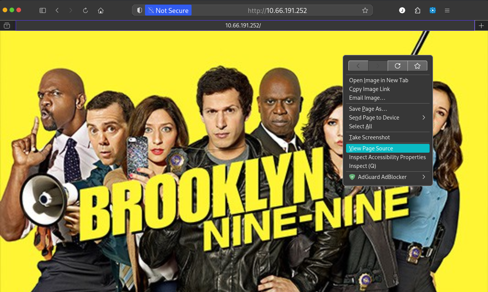

**Action:** Opened the target's HTTP service and inspected the hosted Brooklyn Nine-Nine page.

**Technical significance:** Manual web reconnaissance establishes the visible application surface before deeper inspection of its resources and source.

### 05 — HTML Source Inspection

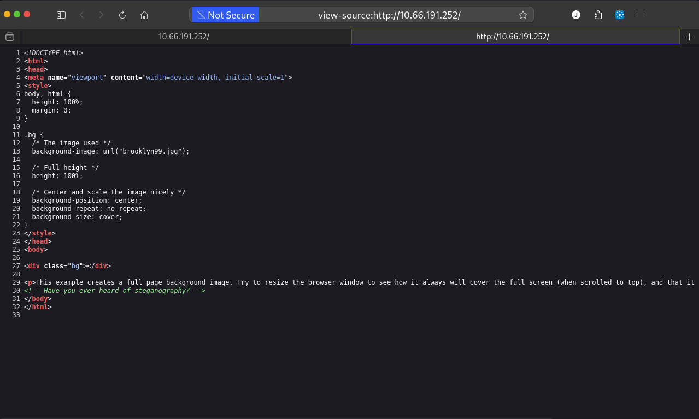

**Action:** Inspected the page source and its referenced resources.

**Observation:** The source inspection identified the page's image resource, `brooklyn99.jpg`, as a candidate for local analysis.

**Technical significance:** Source review can reveal resource names, comments and implementation details that are not visible in the rendered page.

### 06 — Image Metadata Analysis

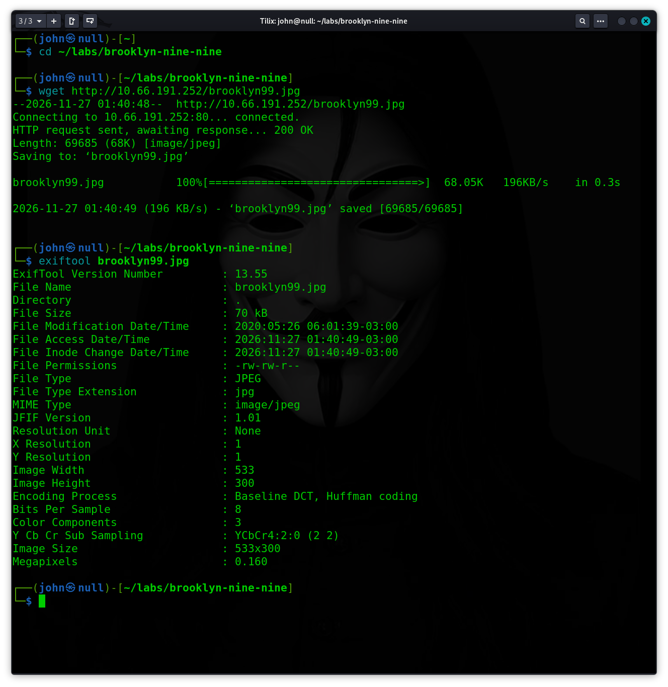

**Action:** Examined the downloaded image with ExifTool.

**Technical significance:** Metadata inspection checks whether a file contains descriptive or potentially useful embedded metadata. The presence of metadata alone does not establish that a file contains a hidden payload.

### 07 — Web Directory Enumeration

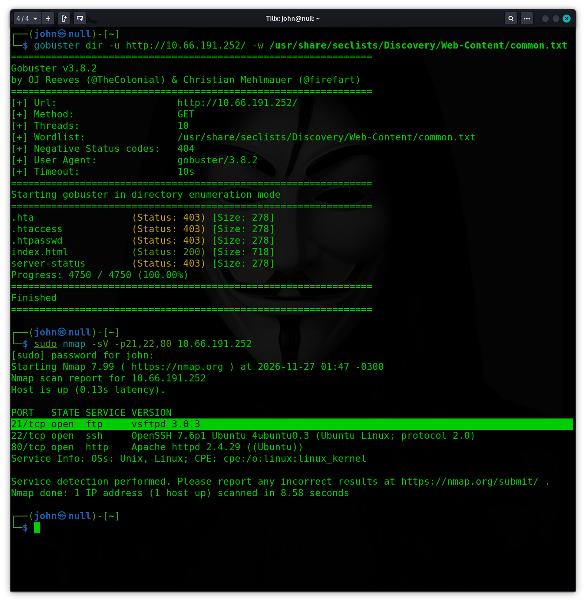

**Action:** Enumerated candidate web paths with Gobuster.

**Observation:** The recorded results include an accessible `index.html` response and paths returning HTTP 403.

**Technical significance:** HTTP 403 means the server refused access to a requested resource; it does not mean the resource is absent.

### 08 — FTP Anonymous Access

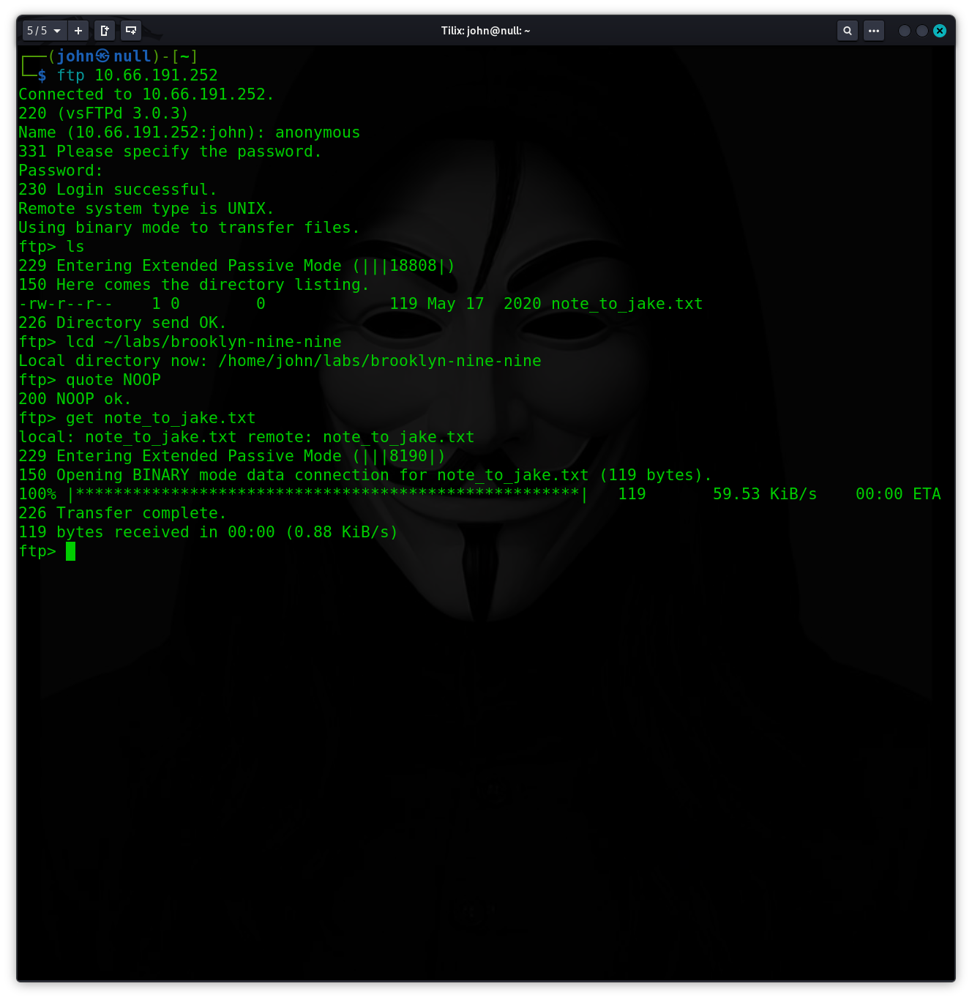

**Action:** Tested the FTP service and confirmed that the lab accepted an anonymous session.

**Technical significance:** Anonymous FTP can expose files without individual authentication and should be disabled when it is not explicitly required.

### 09 — Password Wordlist Analysis

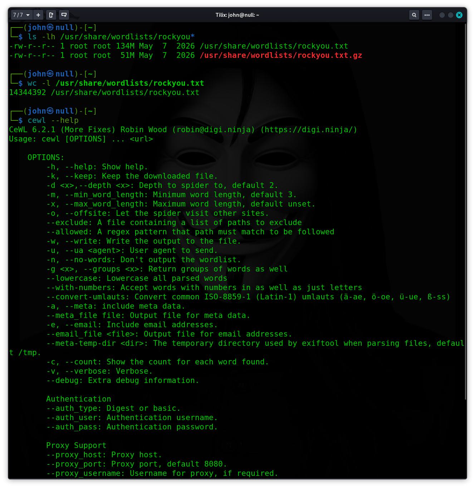

**Action:** Prepared and reviewed the RockYou wordlist for the authorized authentication test.

**Technical significance:** Wordlists are used in controlled password-auditing exercises to evaluate password strength. Their use must remain within the explicitly authorized lab scope.

### 10 — FTP Intelligence: Note to Jake

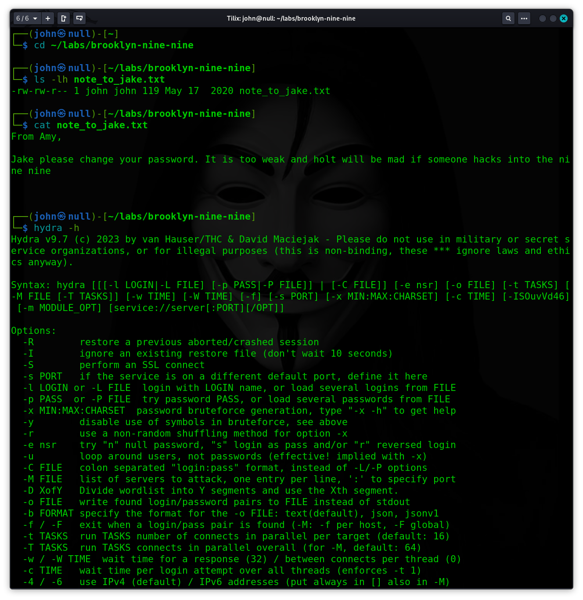

**Action:** Retrieved and inspected `note_to_jake.txt` from the FTP service.

**Observation:** The note provided a lead for the subsequent password investigation.

**Technical significance:** Files exposed by a service can provide context for later tests. Findings should be treated as leads and validated rather than assumed to be proof.

### 11 — SSH Authentication Testing with Hydra

> **Sensitive capture:** This screenshot may expose a recovered credential. Keep the original in the private evidence archive and replace the repository copy with a redacted version before public display.

**Action:** Used Hydra for password auditing against the lab's SSH service with the selected wordlist.

**Technical significance:** The test demonstrated the risk of weak credentials. Do not publish the recovered password or a complete credential pair.

### 12 — User-Level Flag Discovery

> **Sensitive capture:** Redact the flag value before publishing this screenshot.

**Action:** Located the user-level objective file during the post-login enumeration phase.

**Technical significance:** The user flag confirms progress under the unprivileged account; it does not demonstrate administrative access.

### 13 — User Flag Validation

> **Sensitive capture:** Redact the submitted flag value before publishing this screenshot. Keep only the room's successful validation status visible.

**Action:** Submitted the user-level flag to TryHackMe and recorded the successful validation.

**Technical significance:** Platform validation independently confirms that the discovered value satisfied the room objective.

### 14 — Sudo Privilege Enumeration

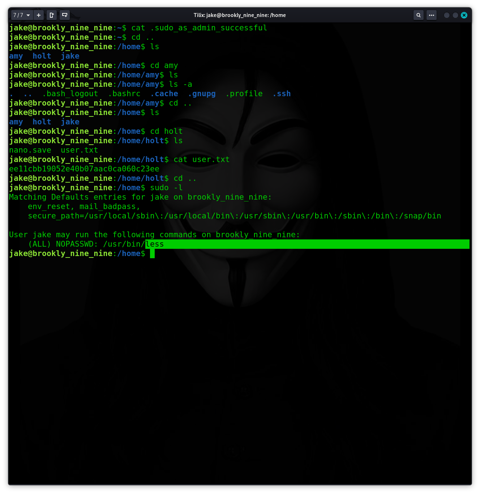

**Action:** Reviewed the account's permitted sudo commands.

**Observation:** The recorded sudo policy allowed `/usr/bin/less` to run as root without a password.

**Technical significance:** A pager is not a safe privilege boundary when it can spawn a shell. Sudo rules should follow least privilege and avoid granting root execution to shell-capable utilities.

### 15 — GTFOBins Reference: less Shell Escape

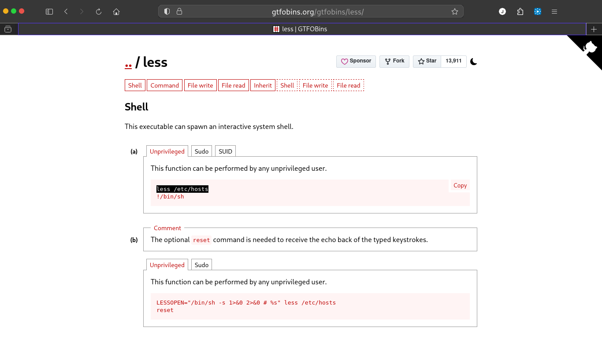

**Action:** Consulted the GTFOBins documentation for the shell-escape behavior of `less`.

**Technical significance:** GTFOBins documents how legitimate Unix binaries can be abused in particular privilege contexts. A reference describes a technique; the lab's own terminal output is the evidence that it worked in this environment.

### 16 — Preparing the Privilege Escalation Path

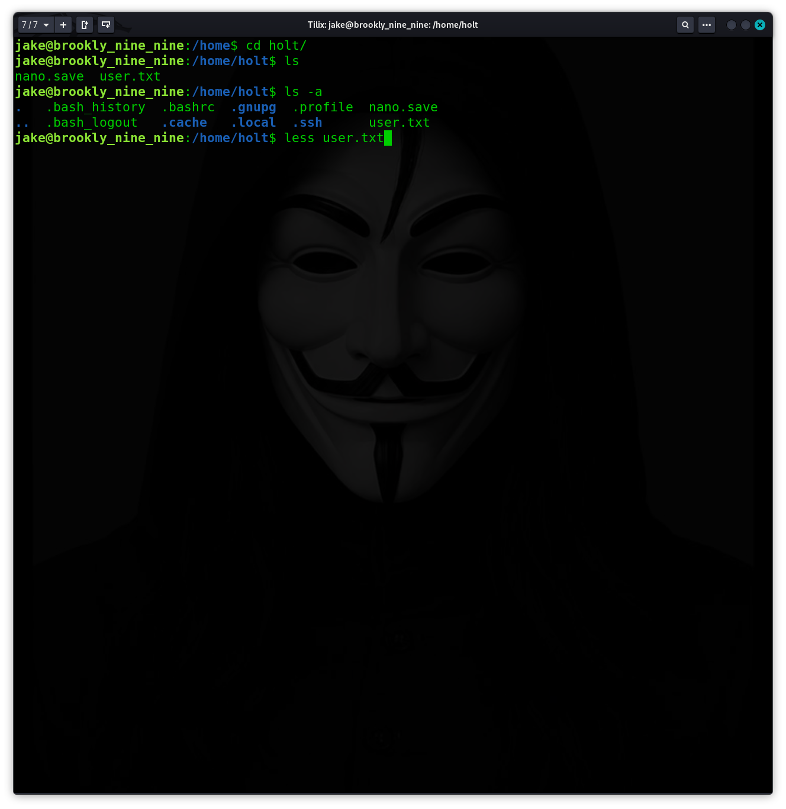

**Action:** Prepared the permitted `less` invocation for the controlled privilege-escalation test.

**Technical significance:** This step connects the sudo policy finding to the documented behavior of the pager. The critical condition is that `less` is executed with elevated privileges.

### 17 — Inspecting User-Level File Content with less

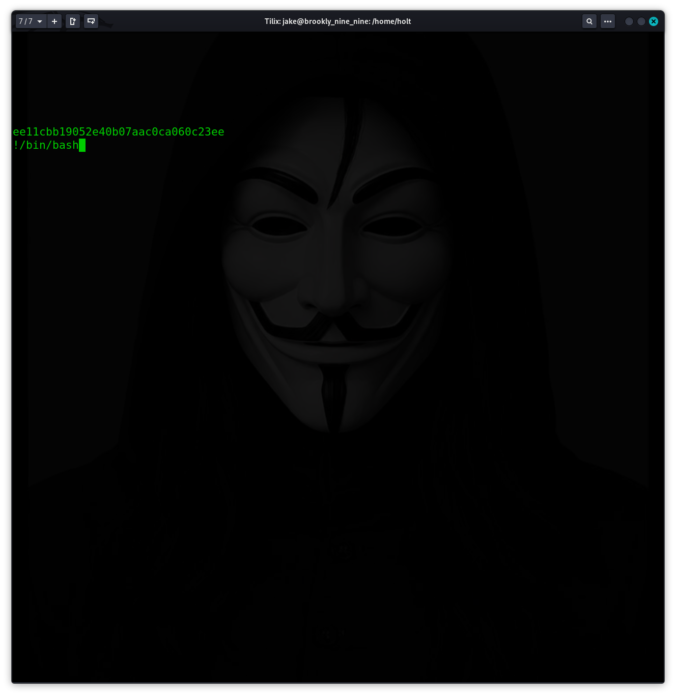

**Action:** Used `less` to inspect the user-level file in the lab environment.

**Technical significance:** This capture records the pager context immediately before the escalation step. The relevant security issue is the shell-escape capability of the privileged binary, not ordinary file viewing by itself.

### 18 — Root Shell Verification

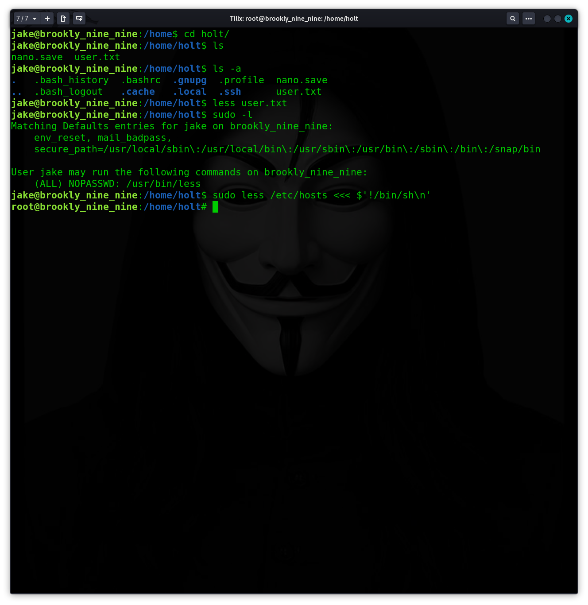

**Action:** Triggered the documented shell escape through the sudo-authorized pager and verified the effective identity with `whoami`.

**Observation:** The command returned `root`.

**Technical significance:** Checking the effective identity provides direct confirmation that the privilege boundary was crossed in the lab.

### 19 — Root Flag Discovery

> **Sensitive capture:** The terminal screenshot contains the root flag. Do not display it publicly until the flag value has been redacted.

**Action:** Accessed `/root/root.txt` after verifying root-level access.

**Technical significance:** This records discovery of the room's root-level objective. The flag value is intentionally excluded from the public write-up.

### 20 — Root Flag Validation

> **Sensitive capture:** Redact the submitted root flag value before publishing this screenshot. Keep the successful validation status visible.

**Action:** Submitted the root-level flag to TryHackMe and recorded the successful validation.

**Technical significance:** The platform's validation status confirms completion of the final room objective.

---

## Security observations

- **Exposed services:** FTP, SSH and HTTP provided the initial enumeration surface.
- **Anonymous FTP:** Unauthenticated file access exposed information useful to the assessment.
- **Weak authentication:** Password auditing identified the risk of weak SSH credentials.
- **Excessive sudo permission:** Allowing a pager to execute as root enabled a shell escape and privilege escalation.
- **Least privilege:** Administrative command allowlists must exclude utilities that can spawn unrestricted shells unless there is a justified and tightly controlled need.

## References

- [Nmap Reference Guide](https://nmap.org/book/man.html)
- [ExifTool Documentation](https://exiftool.org/)
- [Gobuster](https://github.com/OJ/gobuster)
- [THC Hydra](https://github.com/vanhauser-thc/thc-hydra)
- [OpenSSH Manual](https://www.openssh.com/manual.html)
- [sudo Documentation](https://www.sudo.ws/docs/)
- [GTFOBins — less](https://gtfobins.github.io/gtfobins/less/)

## Scope and responsible use

All activity documented here was performed in the TryHackMe training environment. Do not apply these techniques to systems without explicit authorization. This repository documents an educational lab and does not claim commercial penetration-testing experience.
