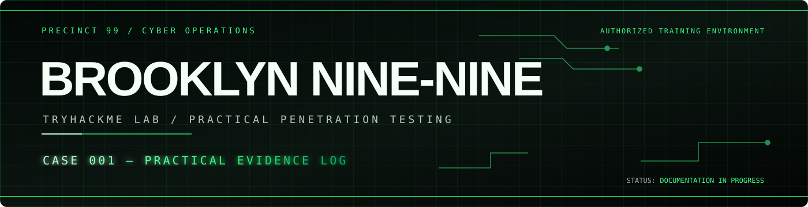

<!--
PRACTICAL EVIDENCE — BROOKLYN NINE-NINE
All screenshot slots below are intentionally pending. Do not replace them with illustrative or generated images.
-->

  
  
<strong>AUTHORIZED LAB • EVIDENCE-DRIVEN WALKTHROUGH • CASE 001</strong>

  
TRYHACKME / BROOKLYN NINE-NINE / LINUX PENETRATION TESTING

# Practical Evidence

A chronological record of the practical work completed in the authorized TryHackMe **Brooklyn Nine-Nine** lab. This page is designed around original terminal and lab captures, with concise explanations of what each item demonstrates.

> **Evidence status:** The repository currently contains no original screenshot files. The 15 image slots are therefore marked as pending. The findings below reflect the descriptions already present in the repository's former evidence index; add and review each original capture before treating it as published visual proof.

## Assessment at a glance

| Item | Details |
|:--|:--|
| Platform | TryHackMe |
| Lab | Brooklyn Nine-Nine |
| Environment | Kali Linux / assigned TryHackMe lab network |
| Scope | Authorized educational environment only |
| Workflow | Reconnaissance → enumeration → authentication testing → Linux enumeration → privilege escalation |
| Evidence | Original screenshots pending upload |

## Skills practiced

**OpenVPN · ICMP reachability checks · Nmap · HTTP inspection · ExifTool · Gobuster · FTP · Hydra · SSH · Linux enumeration · sudo policy review · privilege escalation analysis · technical reporting**

---

## Practical walkthrough

### 01 — Lab Environment & VPN Connectivity

CASE 001 / EVIDENCE 01 / ORIGINAL CAPTURE PENDING

> **SCREENSHOT PENDING** — Add the original, reviewed capture as `assets/evidence/01-evidence.png`. No image is displayed here because the source file is not currently present in the repository.

**What I did:** The lab workstation was connected to the TryHackMe network through OpenVPN. The recorded notes describe a successfully established tunnel and a reachability check against the target.

**Technical observation:** Connectivity verification establishes the authorized network path before scanning.

**Publication note:** Redact credentials, flag values, VPN configuration, tokens and personal information. Do not alter command output or technical results.

---

### 02 — Network Reconnaissance — Nmap

CASE 001 / EVIDENCE 02 / ORIGINAL CAPTURE PENDING

> **SCREENSHOT PENDING** — Add the original, reviewed capture as `assets/evidence/02-evidence.png`. No image is displayed here because the source file is not currently present in the repository.

**What I did:** The recorded scan identified the target as reachable and reported TCP services on ports 21, 22 and 80. The archived notes describe FTP, SSH and HTTP as the exposed services.

**Technical observation:** Service discovery narrows the assessment to the network-facing attack surface.

**Publication note:** Redact credentials, flag values, VPN configuration, tokens and personal information. Do not alter command output or technical results.

---

### 03 — Web Reconnaissance — HTTP

CASE 001 / EVIDENCE 03 / ORIGINAL CAPTURE PENDING

> **SCREENSHOT PENDING** — Add the original, reviewed capture as `assets/evidence/03-evidence.png`. No image is displayed here because the source file is not currently present in the repository.

**What I did:** The target's HTTP service presented the Brooklyn Nine-Nine themed page. The page source was inspected and referenced the `brooklyn99.jpg` image.

**Technical observation:** Inspecting page content and source can reveal resources and clues that are not obvious from the rendered page.

**Publication note:** Redact credentials, flag values, VPN configuration, tokens and personal information. Do not alter command output or technical results.

---

### 04 — Image Analysis — ExifTool

CASE 001 / EVIDENCE 04 / ORIGINAL CAPTURE PENDING

> **SCREENSHOT PENDING** — Add the original, reviewed capture as `assets/evidence/04-evidence.png`. No image is displayed here because the source file is not currently present in the repository.

**What I did:** The referenced image was downloaded and examined locally with ExifTool. The previous archive records the metadata-review step, but does not establish a hidden payload or a specific metadata finding.

**Technical observation:** Metadata inspection is a low-impact way to check whether a file exposes useful descriptive information.

**Publication note:** Redact credentials, flag values, VPN configuration, tokens and personal information. Do not alter command output or technical results.

---

### 05 — Directory Enumeration — Gobuster

CASE 001 / EVIDENCE 05 / ORIGINAL CAPTURE PENDING

> **SCREENSHOT PENDING** — Add the original, reviewed capture as `assets/evidence/05-evidence.png`. No image is displayed here because the source file is not currently present in the repository.

**What I did:** Gobuster was used to enumerate candidate web paths. The previous archive records a successful response for `index.html` and several `403 Forbidden` responses.

**Technical observation:** A `403` response indicates that access was forbidden; it does not prove that a path is absent or disclose its contents.

**Publication note:** Redact credentials, flag values, VPN configuration, tokens and personal information. Do not alter command output or technical results.

---

### 06 — FTP Enumeration — Anonymous Access

CASE 001 / EVIDENCE 06 / ORIGINAL CAPTURE PENDING

> **SCREENSHOT PENDING** — Add the original, reviewed capture as `assets/evidence/06-evidence.png`. No image is displayed here because the source file is not currently present in the repository.

**What I did:** The FTP service accepted an anonymous login in the lab. The directory listing exposed `note_to_jake.txt`.

**Technical observation:** Anonymous access can expose files without an individual account and should be explicitly disabled when not required.

**Publication note:** Redact credentials, flag values, VPN configuration, tokens and personal information. Do not alter command output or technical results.

---

### 07 — Password Investigation

CASE 001 / EVIDENCE 07 / ORIGINAL CAPTURE PENDING

> **SCREENSHOT PENDING** — Add the original, reviewed capture as `assets/evidence/07-evidence.png`. No image is displayed here because the source file is not currently present in the repository.

**What I did:** The retrieved note was reviewed as a lead for the next authentication-testing stage. The previous archive describes it as a warning about Jake's weak password.

**Technical observation:** Treating discovered files as evidence-led leads helps connect enumeration findings to the next test.

**Publication note:** Redact credentials, flag values, VPN configuration, tokens and personal information. Do not alter command output or technical results.

---

### 08 — SSH Authentication — Hydra

CASE 001 / EVIDENCE 08 / ORIGINAL CAPTURE PENDING

> **SCREENSHOT PENDING** — Add the original, reviewed capture as `assets/evidence/08-evidence.png`. No image is displayed here because the source file is not currently present in the repository.

**What I did:** Hydra was used for password auditing against the lab's SSH service with a wordlist. The previous archive records one valid credential pair; the password must remain redacted.

**Technical observation:** Weak-password testing demonstrates why unique passwords, rate limiting and monitoring matter. Never publish the recovered password.

**Publication note:** Redact credentials, flag values, VPN configuration, tokens and personal information. Do not alter command output or technical results.

---

### 09 — Initial Access — Jake

CASE 001 / EVIDENCE 09 / ORIGINAL CAPTURE PENDING

> **SCREENSHOT PENDING** — Add the original, reviewed capture as `assets/evidence/09-evidence.png`. No image is displayed here because the source file is not currently present in the repository.

**What I did:** An SSH session was established using the lab account `jake`. The archived evidence description records the successful remote session.

**Technical observation:** A successful login establishes an authenticated foothold, not administrative control.

**Publication note:** Redact credentials, flag values, VPN configuration, tokens and personal information. Do not alter command output or technical results.

---

### 10 — Linux Post-Exploitation

CASE 001 / EVIDENCE 10 / ORIGINAL CAPTURE PENDING

> **SCREENSHOT PENDING** — Add the original, reviewed capture as `assets/evidence/10-evidence.png`. No image is displayed here because the source file is not currently present in the repository.

**What I did:** After login, Linux enumeration was performed to understand the user context and inspect available home-directory information. The archived notes mention the `holt` home directory.

**Technical observation:** Post-exploitation enumeration maps local users, permissions and accessible files before privilege escalation.

**Publication note:** Redact credentials, flag values, VPN configuration, tokens and personal information. Do not alter command output or technical results.

---

### 11 — User Flag Discovery

CASE 001 / EVIDENCE 11 / ORIGINAL CAPTURE PENDING

> **SCREENSHOT PENDING** — Add the original, reviewed capture as `assets/evidence/11-evidence.png`. No image is displayed here because the source file is not currently present in the repository.

**What I did:** The user-level objective was located in `user.txt`. The flag value is intentionally not reproduced in this public write-up.

**Technical observation:** The user flag records progress at the unprivileged account level; it should not be confused with root access.

**Publication note:** Redact credentials, flag values, VPN configuration, tokens and personal information. Do not alter command output or technical results.

---

### 12 — Privilege Escalation — Sudo / Less

CASE 001 / EVIDENCE 12 / ORIGINAL CAPTURE PENDING

> **SCREENSHOT PENDING** — Add the original, reviewed capture as `assets/evidence/12-evidence.png`. No image is displayed here because the source file is not currently present in the repository.

**What I did:** The recorded privilege review identified a passwordless sudo rule for `/usr/bin/less`. The pager can provide shell escape functionality when invoked with sufficient privileges.

**Technical observation:** Allowing a general-purpose pager to run as root can cross the intended privilege boundary. Apply least privilege and restrict shell-capable commands.

**Publication note:** Redact credentials, flag values, VPN configuration, tokens and personal information. Do not alter command output or technical results.

---

### 13 — Root Access Verification

CASE 001 / EVIDENCE 13 / ORIGINAL CAPTURE PENDING

> **SCREENSHOT PENDING** — Add the original, reviewed capture as `assets/evidence/13-evidence.png`. No image is displayed here because the source file is not currently present in the repository.

**What I did:** The archived evidence describes using the pager's shell escape and verifying the resulting identity with `whoami`, which returned `root`.

**Technical observation:** Privilege escalation should be verified by checking the effective identity, not inferred from a command merely completing.

**Publication note:** Redact credentials, flag values, VPN configuration, tokens and personal information. Do not alter command output or technical results.

---

### 14 — Root Flag Discovery

CASE 001 / EVIDENCE 14 / ORIGINAL CAPTURE PENDING

> **SCREENSHOT PENDING** — Add the original, reviewed capture as `assets/evidence/14-evidence.png`. No image is displayed here because the source file is not currently present in the repository.

**What I did:** The root-level objective file `root.txt` was accessed. Its value is not included in this public documentation.

**Technical observation:** This records completion of the lab's root-level objective without disclosing the answer.

**Publication note:** Redact credentials, flag values, VPN configuration, tokens and personal information. Do not alter command output or technical results.

---

### 15 — TryHackMe Lab Completion

CASE 001 / EVIDENCE 15 / ORIGINAL CAPTURE PENDING

> **SCREENSHOT PENDING** — Add the original, reviewed capture as `assets/evidence/15-evidence.png`. No image is displayed here because the source file is not currently present in the repository.

**What I did:** The existing archive describes a room-completion capture. When the original image is added, it should show only the first name João; the surname and any unrelated personal details must be hidden.

**Technical observation:** A completion capture provides context for the learning exercise. It is not a substitute for the technical evidence in the preceding stages.

**Publication note:** Redact credentials, flag values, VPN configuration, tokens and personal information. Do not alter command output or technical results.

---

## Evidence publication checklist

- [ ] Add the original screenshot for each stage to `assets/evidence/` (flat directory; no nested folders).
- [ ] Confirm the capture is readable and shows the relevant command or lab state.
- [ ] Redact passwords, flags, tokens, private configuration and unrelated personal information.
- [ ] For Evidence 15, show only the first name **João**; hide the surname.
- [ ] Replace each pending marker with a relative Markdown image link after the corresponding file has been uploaded and verified.
- [ ] Check every image at GitHub's rendered page size before publication.

## Technical references

- [Nmap Reference Guide](https://nmap.org/book/man.html)
- [ExifTool Documentation](https://exiftool.org/)
- [Gobuster](https://github.com/OJ/gobuster)
- [THC Hydra](https://github.com/vanhauser-thc/thc-hydra)
- [OpenSSH Manual Pages](https://www.openssh.com/manual.html)
- [sudo Documentation](https://www.sudo.ws/docs/)
- [GTFOBins — less](https://gtfobins.github.io/gtfobins/less/)

## Scope and responsible disclosure

All activity documented here belongs to the TryHackMe training environment. Do not apply these techniques to systems without explicit authorization. This portfolio records an educational lab; it does not claim commercial penetration-testing experience.
