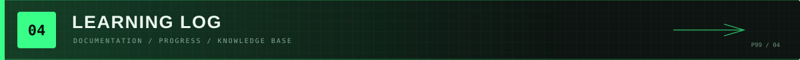

**PRECINCT 99 / TECHNICAL KNOWLEDGE BASE**

FOUNDATIONS • LAB METHODOLOGY • DEFENSIVE SECURITY • REFERENCES

# Documentation Index

This is the technical knowledge base for the Brooklyn Nine-Nine learning project. It follows the instructor's lab sequence and expands each stage into broader cybersecurity concepts.

## 01 / Fundamentals

| Document | Scope |
|:--|:--|
| [Networking & TCP/IP](fundamentals/networking-and-tcp-ip.md) | IP addressing, TCP/UDP, ports, routing and port states. |
| [Web & HTTP](fundamentals/web-and-http.md) | URLs, requests, responses, headers, methods and browser inspection. |
| [Linux & Permissions](fundamentals/linux-and-permissions.md) | Shell, filesystem, users, groups, permissions, processes and sudo. |
| [Authentication & Access](fundamentals/authentication-and-access.md) | Password security, SSH keys, authentication and access controls. |

## 02 / Lab Methodology

These pages explain the instructor-aligned stages. They are learning guides, not room solutions or target-specific walkthroughs.

| Order | Stage | Document |
|:--:|:--|:--|
| 00 | Environment preparation | [Environment Setup](methodology/00-environment-setup.md) |
| 01 | Web reconnaissance | [Web Reconnaissance](methodology/01-web-reconnaissance.md) |
| 02 | Network scanning | [Network Reconnaissance](methodology/02-network-reconnaissance.md) |
| 03 | Service / FTP review | [Service Enumeration & FTP](methodology/03-service-enumeration-and-ftp.md) |
| 04 | SSH / authentication | [SSH & Authentication](methodology/04-ssh-and-authentication.md) |
| 05 | Linux enumeration | [Linux Enumeration](methodology/05-linux-enumeration.md) |
| 06 | Privilege escalation concepts | [Privilege Escalation](methodology/06-privilege-escalation.md) |

## 03 / Defensive Security

| Document | Scope |
|:--|:--|
| [Detection & Monitoring](defense/01-detection-and-monitoring.md) | Logs, network visibility, authentication events and investigation. |
| [Hardening & Remediation](defense/02-hardening-and-remediation.md) | Least privilege, secure service configuration and remediation. |

## 04 / References & Templates

- [Official documentation and references](references/README.md)
- [Technical learning note template](templates/technical-note-template.md)
- [Security review template](templates/security-review-template.md)

## How to use this knowledge base

1. Read the relevant fundamentals page.
2. Follow the corresponding authorized lab stage.
3. Separate direct observations from assumptions.
4. Connect the offensive concept to detection and remediation.
5. Record only permitted, non-sensitive and evidence-based learning.

## Publication boundary

Do not add room flags, credentials, target-specific exploitation chains or restricted walkthroughs. Keep sensitive operational notes and evidence outside version control. Use generic examples in these documents.
