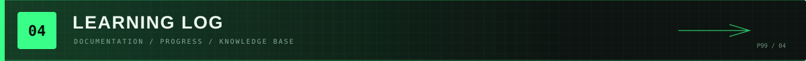

  
  
<strong>PRECINCT 99 / FIELD EVIDENCE ARCHIVE</strong>

  
ORIGINAL LAB CAPTURES • REDACTED SECRETS • DOCUMENTED FINDINGS

# Practical Evidence

This directory contains the screenshots selected to demonstrate the work performed in the authorized TryHackMe Brooklyn Nine-Nine lab. Each capture is referenced from its corresponding methodology chapter.

> **Redaction note:** Passwords and flag values are intentionally obscured. The completion image retains only the first name João, as requested. The screenshots are genuine captures from the lab; redactions do not change the technical findings.

## 01 / Environment and reconnaissance

*OpenVPN initialization completes and the tunnel interface is established.*

*ICMP replies and a SYN scan show the target reachable with TCP/21, TCP/22 and TCP/80 open.*

## 02 / Web reconnaissance

*The target serves the Brooklyn Nine-Nine themed page.*

*The source reveals the brooklyn99.jpg asset and a steganography hint.*

*The image is downloaded and inspected locally with ExifTool.*

*Directory enumeration returns the index and several HTTP 403 responses.*

## 03 / FTP enumeration

*Anonymous FTP login succeeds and the directory listing exposes note_to_jake.txt.*

*The note is successfully retrieved; the transfer reports 119 bytes.*

*The note warns Jake about a weak password, informing the next authentication-testing step.*

## 04 / SSH access and Linux enumeration

*Hydra reports one valid SSH credential pair. The password is redacted.*

*An SSH session is established as the jake account.*

*Home-directory enumeration leads to user.txt. The flag is redacted.*

## 05 / Privilege escalation and completion

*The less shell escape provides a shell whose identity is confirmed by whoami returning root.*

*The root flag file is accessed; its value is redacted.*

*TryHackMe confirms successful room completion. The personal identifier is redacted to the first name only.*

## Evidence handling

- Screenshots substantiate the described practical steps.
- Passwords and flag values are not published.
- The target IP shown in captures is the ephemeral address assigned by the room during the recorded session.
- A screenshot demonstrates what was observed at that moment; interpretation and security impact are explained in the corresponding walkthrough chapter.